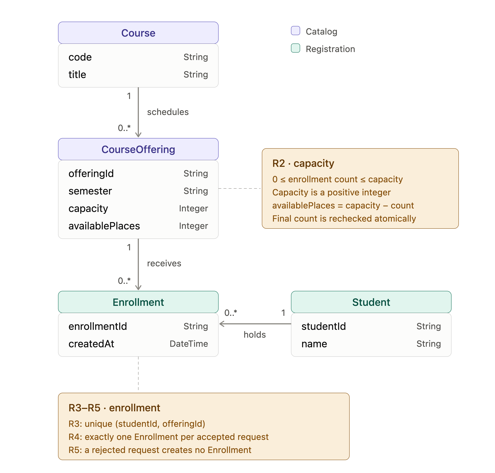
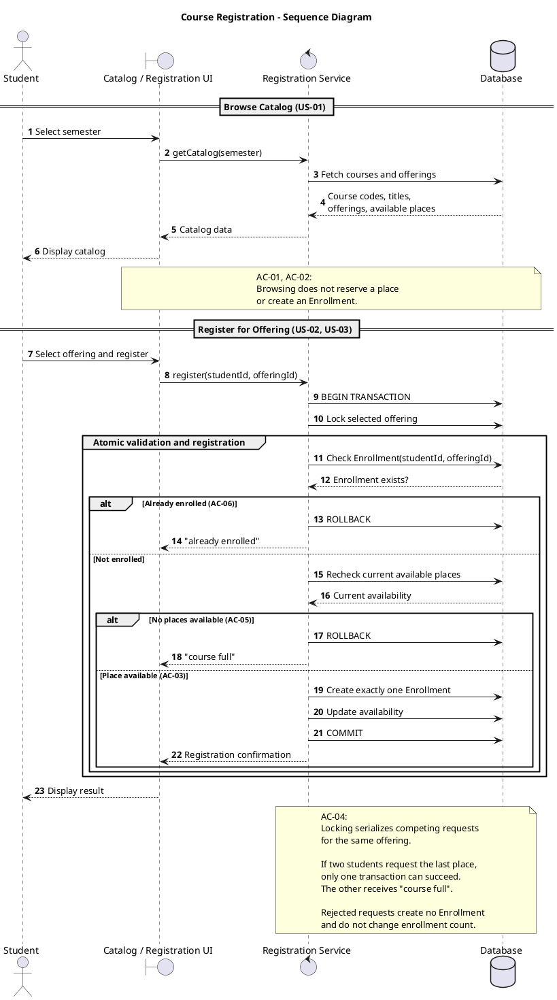
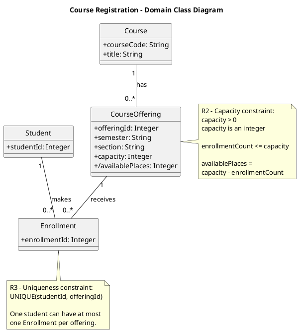
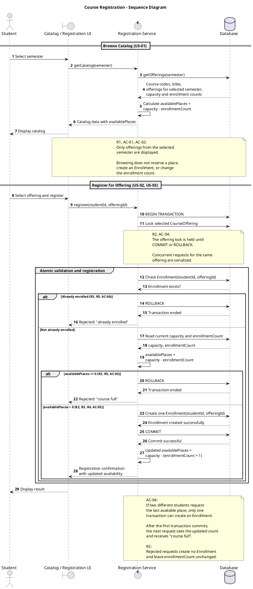
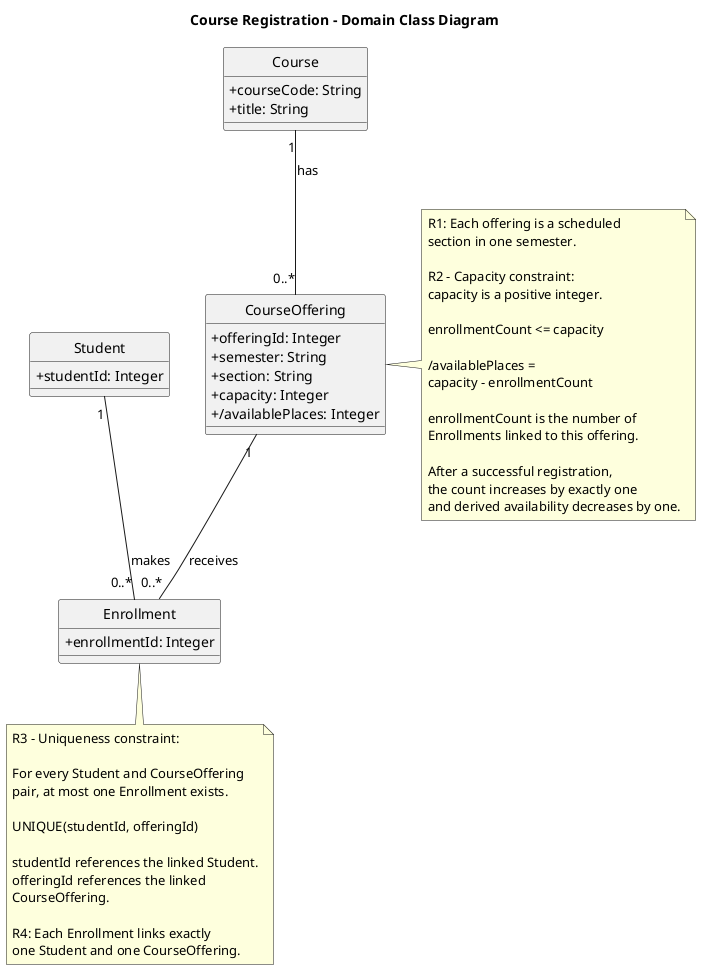
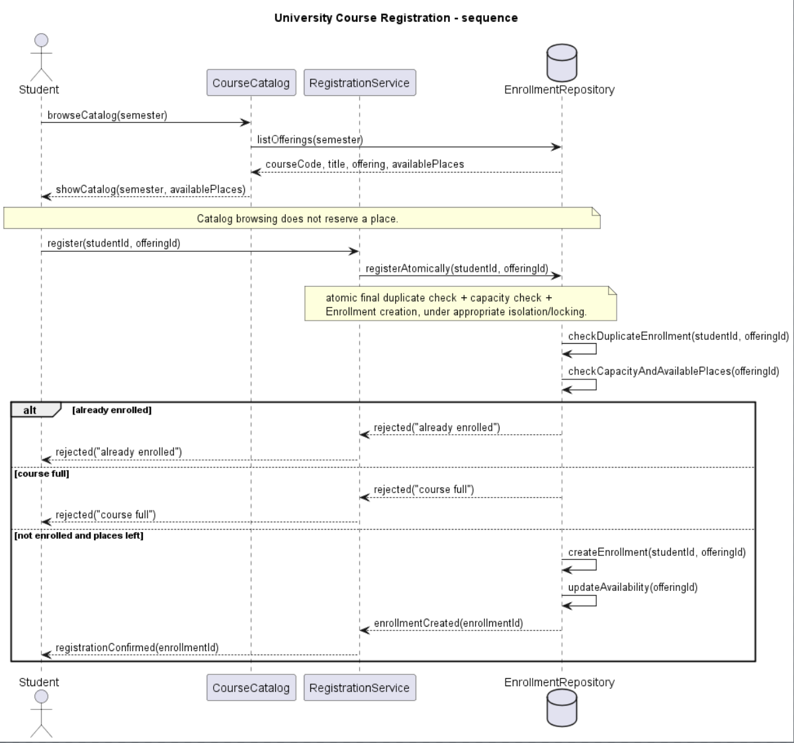
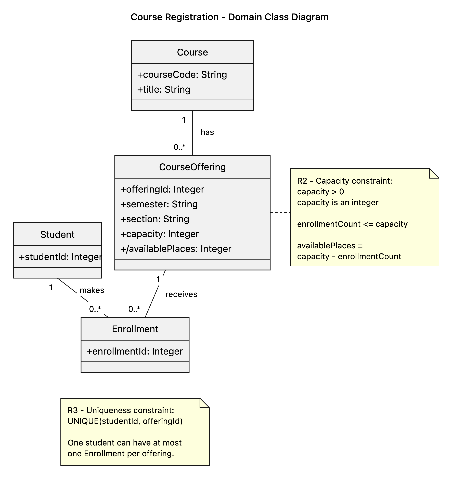

# SIS #02 — AI-Assisted UML Modeling: University Course Registration

<!--
  This is the only file you write your report in. README.md tells you what goes where.

  Rules the checker relies on:
  - Do not delete, rename or renumber the ## headings, the ### headings, or the **Label:** words.
  - Replace every "(write here)" and "(paste here)". None may be left when you submit.
  - Comments like this one are ignored by the checker and the word counter. Delete them or leave them.
-->

## 1. Scope and assumptions

**Scope:** The Smart Campus registration model lets signed-in students browse a semester catalog, select a particular course offering, and request one enrollment. It enforces capacity, duplicate restrictions, successful confirmation, and clear rejection without implementing payment, prerequisites, timetable clashes, waiting lists, or cancellation.

**Assumptions:**

1. The selected offering exists, the student is signed in, and capacity is a positive integer, as supplied by the scenario.
2. A displayed catalog count is informative only; the final availability check and enrollment creation occur atomically on registration.
3. The fictional system identifies each Enrollment by a single student and CourseOffering. The persistence mechanism is proposed, not specified.

## 2. User stories and acceptance criteria

### US-01 — Browse offerings

**US-01:** As a student, I want to browse the electronic catalog for a selected semester so that I can view offerings and available places before requesting registration.

- **AC-01** (R1): Given the student is signed in and selects a semester, When the student opens the course catalog, Then the system displays the course code, title, scheduled offering, and available places for that semester.
- **AC-02** (R1, R2): Given an offering has available places, When the student views it in the catalog, Then no Enrollment is created, no place is reserved, and the enrollment count remains unchanged.

### US-02 — Register for an offering

**US-02:** As a student, I want to register for a specific offering so that I can secure a place if capacity is available and I am not already enrolled.

- **AC-03** (R2, R3, R4): Given the student is signed in, the offering has a free place, and the student is not enrolled, When the student requests registration, Then the system atomically rechecks capacity and duplicates, creates exactly one Enrollment, updates availability, and confirms registration.
- **AC-04** (R2, R4, R5): Given exactly one place remains and two different students are eligible, When they request registration concurrently, Then the final checks and creation are atomic, exactly one succeeds, and the other receives "course full" without another Enrollment.

### US-03 — Receive a clear rejection

**US-03:** As a student, I want an explanation for a rejected registration so that I understand whether the offering is full or I am already enrolled.

- **AC-05** (R2, R5): Given the offering is full and the student is not enrolled, When registration is requested, Then the system returns "course full", creates no Enrollment, and leaves the count unchanged.
- **AC-06** (R3, R5): Given the student is already enrolled and the offering still has places, When the student requests registration again, Then the system returns "already enrolled", creates no additional Enrollment, and leaves the count unchanged.

**Review of Prompt A:** All three stories and six criteria remain within the stated scope. The malformed matrix in the pasted AI output was not retained; the rule IDs beside each criterion are the authoritative mapping. A simultaneous full-and-duplicate condition has unspecified precedence; this model checks duplicate first as an explicit engineering choice.

## 3. Sequence diagram


**Participants:** Student is the requester; Catalog / Registration UI displays semester listings; Registration Service coordinates requests; Database supplies current records and handles transaction processing.

**Atomic operation:** The group `Atomic validation and registration` encloses the duplicate and current-capacity checks and creation inside one transaction. The offering lock is held until COMMIT or ROLLBACK. A catalog request only returns a snapshot and does not reserve capacity.

**Where the Enrollment is created:** In the `else not enrolled and places left` branch, `Registration Service` sends `Create one Enrollment(studentId, offeringId)` to `Database`, creating exactly one instance of `Enrollment` in the class diagram.

**Technical lifelines:** `Catalog / Registration UI`, `Registration Service`, and `Database` are technical boundary, control, and persistence responsibilities, not domain entities. The class diagram deliberately focuses on Student, Course, CourseOffering and Enrollment.

## 4. Class diagram



| Association | Read left to right | Read right to left |
| --- | --- | --- |
| Course `1` — CourseOffering `0..*` | One course can have zero or many scheduled offerings. | Every offering refers to exactly one course. |
| Student `1` — Enrollment `0..*` | A student may hold zero or many enrollments. | Every Enrollment belongs to exactly one student. |
| CourseOffering `1` — Enrollment `0..*` | An offering may receive zero or many enrollments subject to capacity. | Every Enrollment refers to exactly one offering. |

**How an Enrollment links a student to an offering:** Two mandatory associations tie one Enrollment to exactly one Student and one CourseOffering; `enrollmentId` identifies the resulting registration.

**Capacity constraint:** R2 requires `count(Enrollment for offering) <= CourseOffering.capacity` for a positive integer capacity, enforced at registration. The `0..*` multiplicity does not encode a dynamic capacity value or concurrent access control.

**Uniqueness constraint:** R3 requires a unique `(studentId, offeringId)` combination. Multiplicity describes structural links but does not express uniqueness across pairs of linked objects.

## 5. Traceability

| Rule and criterion | Model evidence | Validation case |
| --- | --- | --- |
| R1 + AC-01, AC-02 | `getCatalog(semester)`, `getOfferings(semester)`, Course.courseCode/title, CourseOffering.semester and /availablePlaces; catalog does not reserve | Catalog-only inspection before T1 |
| R2 + AC-02, AC-03, AC-04, AC-05 | `Read current capacity and enrollmentCount` inside atomic transaction; CourseOffering capacity note | T2, T3 |
| R3 + AC-03, AC-06 | `Check Enrollment(studentId, offeringId)`, `Already enrolled` guard, Enrollment uniqueness note | T4 |
| R4 + AC-03, AC-04 | `Create one Enrollment`, derived availability calculation, `Registration confirmation` in success branch | T1, T2 |
| R5 + AC-04, AC-05, AC-06 | Separate `already enrolled` and `course full` guarded rejection replies, with no creation | T3, T4 |

## 6. Walkthroughs

| Case | Observed path and state change | Judgment and evidence |
| --- | --- | --- |
| T1. Available | Catalog → register → atomic duplicate check (false) → current capacity check (0 < 2) → success guard → Create one Enrollment → COMMIT → recalculate availability → confirmation; count **0 → 1**. | Pass — `availablePlaces > 0` and `Create one Enrollment` / `Registration confirmation` messages. |
| T2. Last place | Catalog → register → atomic duplicate check (false) → current capacity check (1 < 2) → success guard → Create one Enrollment → COMMIT → recalculate availability → confirmation; count **1 → 2**, available places 0. | Pass — success guard and atomic check note ensure the final available place is used only once. |
| T3. Full | Catalog may show one stale place → register → current duplicate check (false) → capacity check (2 = 2) → `availablePlaces <= 0` → rejected("course full"); count **2 → 2**, no creation. | Pass — `availablePlaces <= 0` rejection branch without create, update or confirm messages. |
| T4. Duplicate | Catalog → register → atomic duplicate check (true) → `Already enrolled` → rejected("already enrolled"); count **1 → 1**, no second Enrollment. | Pass — `Already enrolled` guard and rejection reply; uniqueness note on Enrollment. |

## 7. Review decisions

| AI critique / model element | Decision | Reason and evidence | Rule |
| --- | --- | --- | --- |
| D-01: `Fetch courses and offerings` did not show semester filtering | accept | Changed to `getOfferings(semester)` because AC-01 limits the catalog to the selected semester. | R1, AC-01 |
| D-02: `Lock selected offering` had no stated lock lifetime | accept | Added a note holding the offering lock until COMMIT or ROLLBACK, preventing simultaneous last-seat successes. | R2, AC-04 |
| D-03: creation and confirmation lacked explicit successful database replies | accept | Added creation and commit success replies before the confirmation to avoid confirming uncommitted records. | R4, AC-03 |
| D-04: `Update availability` conflicted with derived `/availablePlaces` | accept | Removed separate stored update, recalculating from capacity and committed Enrollment count instead. | R2, R4 |
| D-05: `UNIQUE(studentId, offeringId)` was not tied clearly to associations | accept | Explained that uniqueness applies to the Student and CourseOffering referenced by each Enrollment. | R3, AC-06 |
| Duplicate-first branch priority | keep | The requirements do not specify priority when full and duplicate are both true; this remains a documented modeling choice. | R3, R5 |

## 8. Modeling explanation

The two models answer different engineering questions. The sequence diagram describes what the system does in time, while the class diagram identifies the persistent domain concepts and their structural relationships. A Student browses the Catalog / Registration UI for a chosen semester and sees a Course code, title, a scheduled CourseOffering, and the number of free places. This action does not reserve a seat. Later, the student requests registration for one specific CourseOffering. The Registration Service invokes an atomic decision in Database, which checks whether the student is already enrolled and whether current capacity remains before creating an Enrollment.

The crucial choice is to use one atomic unit for the final checks and creation. The catalog's available-place count may become stale immediately, especially when two students compete for the last seat. Accordingly, a success path creates exactly one Enrollment, changes the available count, and only then sends confirmation. The full and duplicate paths send clear reasons without creating a record or changing the count. The sequence diagram presents these as distinct guards so that the four prescribed validation cases can be traced message by message.

In the domain model, Course has a code and title, whereas CourseOffering represents one semester section with a capacity. Enrollment links exactly one Student to one offering. Associations show structural multiplicities, but a note states the dynamic capacity constraint and another specifies the unique student-offering pair. Neither property can safely be inferred from multiplicity alone. Catalog / Registration UI, Registration Service, and Database are technical lifelines, deliberately omitted from the domain diagram.

An activity diagram could complement these models by emphasizing decisions and alternative routes without detailing messages between collaborators. It would be useful for explaining the process to nontechnical stakeholders, but the sequence diagram better exposes the critical atomic operation.

## 9. Reflection

This work showed me that producing a plausible diagram is not enough to demonstrate correct registration behavior. The two most important questions are when the system checks remaining capacity and whether a duplicate request can create another Enrollment. The T3 case is especially informative: a catalog view can show an available place even though the offering becomes full before registration. That made me pay attention to the difference between displaying information and committing a transaction.

The class diagram also forced me to distinguish an offering from a course. A course name and code describe a subject, while a particular offering has the semester and capacity needed for registration. Separating them keeps the model closer to the stated scenario. The enrollment associations describe which objects are related, but cannot guarantee concurrency safety or prevent repeated registrations without further restrictions.

AI assistance suggested lifelines and relationships. The model still describes an atomic operation without implementing or testing it. I would require concurrency tests and a verified isolation strategy before deploying such a system. This reflection is an AI-assisted draft and must be personalized before submission.

## 10. Appendix A — Before AI

**Scope:** This model covers university course catalog browsing and registration for a specific course offering. It includes semester-specific availability, capacity checks, duplicate prevention, successful enrollment confirmation, and clear rejection messages. Payments, prerequisites, timetable clashes, waiting lists, and cancellation are outside scope.

**Initial assumptions:**

1. The student is already signed in, and the selected CourseOffering exists with a positive integer capacity, as stated in the scenario.
2. The catalog displays availability but does not reserve a place; current availability and duplicate enrollment must be rechecked atomically when registration is requested.
3. An Enrollment links exactly one Student to one CourseOffering and is created only when the registration checks succeed.

**Process disclosure:** The first commit, 8b40ac8, contained the unfilled report template. These assumptions were reconstructed after Prompt A from the scenario and the actual Prompt A request. They were not committed before Prompt A. The original Git history has not been changed.

## 11. Appendix B — AI exchanges

<!-- Complete prompts and complete responses, as text — never screenshots. Paste each inside
     the ~~~~ block that follows its label: AI responses contain ``` PlantUML blocks, and
     ~~~~ keeps them from breaking this file. Prompts B and C: the prompt text first, then
     the material it refers to ("below", "these two") pasted under it, in the same block.
     You may add B5, B6 … after B4 if you ran more. -->

### B1 — Requirements (Prompt A)

- **Tool:** ChatGPT
- **Model:** GPT-6
- **Date:** 2026-10-12
- **Purpose:** draft 3 user stories and 6 acceptance criteria

<!-- Model: the exact model with its version, as the tool shows it (e.g. "GPT-5 Thinking",
     "Claude Sonnet 4.5"). If the tool does not show it, write: not displayed
     Date: YYYY-MM-DD -->

**Prompt:**

~~~~text
Act as a requirements analyst. Use only this course registration scenario and rules R1–R5: A student browses an electronic course catalog, chooses a course offering and requests registration. Each offering has a limited number of places. A Course describes a subject. A CourseOffering is one scheduled section in one semester. Registration always targets a specific offering. Assume that the student is signed in, the selected offering exists, and its capacity is a positive whole number. R1. Catalog: Show course code, title, offering and available places for one semester. R2. Capacity: Recheck current availability when registering; never exceed capacity. R3. Duplicates: At most one enrollment for one student in the same offering. R4. Success: Create exactly one Enrollment, update availability, and return a confirmation. R5. Rejection: Explain course full or already enrolled; create no enrollment and do not change count. A catalog view reserves nothing. Final checks and enrollment creation are atomic. Out of scope: payments, prerequisites, timetable clashes, waiting lists, cancellation. My initial assumptions are that the signed-in student and positive-capacity offering are given, the catalog does not reserve seats, and Enrollment links one student and offering.
Draft 3 user stories and 2 Given / When / Then acceptance criteria for each. Use IDs US-01 to US-03 and AC-01 to AC-06. Map each criterion to rule IDs.
Cover normal and rejection behavior. List uncertainty separately. Do not add excluded features or invent university policies.
~~~~

**Response:**

~~~~text
# User Stories and Acceptance Criteria — University Course Registration

## US-01 — Browse Course Catalog
As a student, I want to browse the electronic course catalog for a selected semester so that I can view course offerings and their available places before requesting registration.
AC-01 — Display Course Offerings: Given the student is signed in and selects a semester, When the student opens the course catalog, Then the system displays course code, title, scheduled offering and available places (R1).
AC-02 — Catalog Does Not Reserve Places: Given an offering has available places, When the student views it, Then no Enrollment is created, no place reserved and the count remains unchanged (R1, R2).

## US-02 — Register for a Course Offering
As a student, I want to register for a specific course offering so that I can secure a place if capacity is available and I am not already enrolled.
AC-03 — Successful Registration: Given the student is signed in, the offering has an available place and the student is not enrolled, When registration is requested, Then final capacity and duplicate checks run atomically, one Enrollment is created, availability updated and a confirmation returned (R2, R3, R4).
AC-04 — Concurrent Registration for the Last Place: Given one remaining place and two eligible students, When both register concurrently, Then one succeeds and the other is rejected as course full, with no overcapacity (R2, R4, R5).

## US-03 — Handle Registration Rejections
As a student, I want to receive a clear explanation when registration fails so that I understand why I was not enrolled.
AC-05 — Full: Given the offering is full and the student is not enrolled, When registration is requested, Then return course full and leave count unchanged (R2, R5).
AC-06 — Duplicate: Given the student is enrolled and places remain, When registering again, Then return already enrolled and leave the count unchanged (R3, R5).

Uncertainties include semester selection, implementation of atomic concurrency control, precedence where both failure conditions apply, confirmation format and whether availability is stored or derived.
Scope excludes payments, prerequisites, timetable clashes, waiting lists and cancellation.
~~~~

### B2 — UML drafts (Prompt B)

- **Tool:** ChatGPT
- **Model:** GPT-6
- **Date:** 2026-10-12
- **Purpose:** generate original sequence and class UML drafts

**Prompt:**

~~~~text
Using my approved scenario, R1–R5, stories and criteria below, return separate PlantUML code blocks for a sequence diagram and a domain class diagram.
Sequence: include catalog browsing and guarded success, full-course and duplicate outcomes. Model final checks and creation as one atomic operation.
Class: show domain concepts, useful attributes and multiplicities. State the capacity and uniqueness constraints. Explain assumptions and any technical lifelines.

Scenario: A student browses an electronic course catalog, chooses a course offering and requests registration. Each offering has a limited number of places. A Course describes a subject. A CourseOffering is one scheduled section in one semester. Registration always targets a specific offering. Assume the student is signed in, the selected offering exists, and its capacity is a positive whole number.
R1. Catalog: Show course code, title, offering and available places for one semester.
R2. Capacity: Recheck current availability when registering; never exceed capacity.
R3. Duplicates: Reject more than one Enrollment for the same student and offering.
R4. Success: Create exactly one Enrollment, update availability and confirm.
R5. Rejection: Explain "course full" or "already enrolled", create nothing and do not change count.
Catalog views reserve nothing; registration's final checks and creation must be atomic. Out of scope: payments, prerequisites, timetable clashes, waiting lists and cancellation.

Approved stories and acceptance criteria:
### US-01 — Browse offerings

**US-01:** As a student, I want to browse the electronic catalog for a selected semester so that I can view offerings and available places before requesting registration.

- **AC-01** (R1): Given the student is signed in and selects a semester, When the student opens the course catalog, Then the system displays the course code, title, scheduled offering, and available places for that semester.
- **AC-02** (R1, R2): Given an offering has available places, When the student views it in the catalog, Then no Enrollment is created, no place is reserved, and the enrollment count remains unchanged.

### US-02 — Register for an offering

**US-02:** As a student, I want to register for a specific offering so that I can secure a place if capacity is available and I am not already enrolled.

- **AC-03** (R2, R3, R4): Given the student is signed in, the offering has a free place, and the student is not enrolled, When the student requests registration, Then the system atomically rechecks capacity and duplicates, creates exactly one Enrollment, updates availability, and confirms registration.
- **AC-04** (R2, R4, R5): Given exactly one place remains and two different students are eligible, When they request registration concurrently, Then the final checks and creation are atomic, exactly one succeeds, and the other receives "course full" without another Enrollment.

### US-03 — Receive a clear rejection

**US-03:** As a student, I want an explanation for a rejected registration so that I understand whether the offering is full or I am already enrolled.

- **AC-05** (R2, R5): Given the offering is full and the student is not enrolled, When registration is requested, Then the system returns "course full", creates no Enrollment, and leaves the count unchanged.
- **AC-06** (R3, R5): Given the student is already enrolled and the offering still has places, When the student requests registration again, Then the system returns "already enrolled", creates no additional Enrollment, and leaves the count unchanged.
~~~~

**Response:**

~~~~text
# 1. Sequence Diagram — Course Registration

Covers US-01, US-02, US-03 and AC-01–AC-06. The diagram shows catalog browsing, successful registration, duplicate rejection, full-course rejection, and atomic registration with concurrency protection.



Important: The transaction begins before the final checks and commits only after successful enrollment creation. The offering lock prevents two concurrent transactions from registering for the same last place.

# 2. Domain Class Diagram — Course Registration



Each CourseOffering belongs to one Course; a Course can have many offerings. Each Enrollment links exactly one Student to one CourseOffering. Capacity and the unique student-offering pair are separate constraints. The Student is signed in and offering exists. Catalog / Registration UI, Registration Service, and Database are technical lifelines. Uncertainties include confirmation format, semester selection, rejection priority, persistence strategy and transaction isolation.
~~~~

### B3 — Model critique (Prompt C)

- **Tool:** ChatGPT
- **Model:** GPT-6
- **Date:** 2026-10-12
- **Purpose:** identify model defects and optional design decisions

**Prompt:**

~~~~text
Review these two UML models against R1–R5 and my acceptance criteria. Check message order, guards, state changes, multiplicities and naming.
Inspect the four validation cases: available places, exactly one place, full course after a stale catalog view, and duplicate registration.
For each issue, cite the affected rule and model element. Explain the impact and propose a focused correction. Separate genuine defects from optional design choices.

R1: Show course code, title, offering and available places for one semester.
R2: Recheck capacity and never exceed offering capacity.
R3: Reject duplicate enrollment for the same student and offering.
R4: On success create one Enrollment and confirm.
R5: On rejection explain "course full" or "already enrolled"; create nothing.
Acceptance criteria: AC-01 semester catalog; AC-02 browsing reserves nothing; AC-03 successful atomic registration; AC-04 last-place concurrency; AC-05 full-course rejection; AC-06 duplicate rejection.

Original sequence diagram:

Original class diagram:

~~~~

**Response:**

~~~~text
# UML Model Review — Course Registration

The review examined message order, guards, state changes, multiplicities, naming, and the four validation cases. Both diagrams were broadly consistent with R1–R5 and AC-01–AC-06. Five focused corrections were identified:

D-01 (R1, AC-01) — The sequence message `Fetch courses and offerings` does not explicitly filter by semester. Use `getOfferings(semester)` to avoid displaying offerings from another semester.

D-02 (R2, AC-04) — `Lock selected offering` does not say how long the lock lasts. Hold the lock through the final capacity/duplicate checks until COMMIT or ROLLBACK; otherwise simultaneous last-place registrations might both succeed.

D-03 (R4, AC-03) — `Create exactly one Enrollment` lacks explicit creation and commit replies. Show successful persistence and a successful commit before confirmation, without implying confirmation of failed operations.

D-04 (R2, R4) — `Update availability` in the sequence is inconsistent with the derived `/availablePlaces` in the class diagram. Recalculate availability from the committed Enrollment count instead of treating it as an independently stored field.

D-05 (R3, AC-06) — The uniqueness note `UNIQUE(studentId, offeringId)` mentions attributes not shown directly on Enrollment. Specify that the pair consists of the linked Student and CourseOffering.

Validation cases: Available (capacity 20, count 15) passes and creates one Enrollment; last place (capacity 20, count 19) needs explicit lock lifetime for two competing students; stale catalog view followed by full course correctly rejects with no creation; duplicate registration correctly rejects even where places remain. Multiplicities Course 1-to-many CourseOffering, Student 1-to-many Enrollment, and CourseOffering 1-to-many Enrollment are correct. `0..*` cannot encode dynamic capacity.

Optional choices, not defects: duplicate-first checking when both rejection reasons apply; a separate Registration Service; a Database abstraction; optional enrollmentId; semester and section fields; and Student containing only studentId. Keep these justified choices and clearly separate them from required behavior. D-02 and D-04 are the most consequential issues. The recommended changes preserve the scenario and add no excluded policies.
~~~~

### B4 — Focused revision (Prompt D)

- **Tool:** ChatGPT
- **Model:** GPT-6
- **Date:** 2026-10-12
- **Purpose:** apply accepted critique D-01–D-05

**Prompt:**

~~~~text
Revise the UML sources using only my accepted review decisions: D-01: filter catalog offerings by semester; D-02: hold the offering lock until COMMIT or ROLLBACK; D-03: show successful Enrollment creation and COMMIT before confirmation; D-04: calculate availability as capacity minus enrollment count rather than separately updating a stored field; D-05: make Student–CourseOffering uniqueness explicit. Keep justified existing elements and explain each change.
Preserve the agreed scope and rule IDs. Return both updated PlantUML blocks and a concise change log. Flag any unresolved issue.
Approved requirements: R1 semester catalog; R2 current capacity and no overbooking; R3 no duplicate student/offering enrollment; R4 exactly one Enrollment and confirmation on success; R5 full or duplicate rejection without state change. AC-01 semester catalog, AC-02 no reservation from browsing, AC-03 successful atomic registration, AC-04 last-place concurrency, AC-05 full-course rejection, AC-06 duplicate rejection. US-01 browse, US-02 register, US-03 receive rejection.
Original sources:
Original sequence.puml:

Original classes.puml:

My review decisions and evidence: accept D-01 (AC-01), D-02 (R2/AC-04), D-03 (R4/AC-03), D-04 (R2/R4), D-05 (R3/AC-06). Preserve duplicate-first checking as an optional modeling decision and the technical lifelines as design abstractions.
~~~~

**Response:**

~~~~text
# Revised UML Models — Course Registration

Both diagrams incorporate D-01–D-05, retaining R1–R5, US-01–US-03 and AC-01–AC-06.

Updated sequence diagram:


Updated domain class diagram:


Change log: D-01 uses `getOfferings(semester)`; D-02 adds a lock-through-commit/rollback note; D-03 makes the creation and commit replies explicit before confirmation; D-04 calculates `/availablePlaces` from committed enrollment count; D-05 explains uniqueness over the linked Student and CourseOffering. Retained choices: duplicate-first rejection order, Registration Service and Database lifelines, four domain entities, unchanged association multiplicities. Unresolved details: priority when full and duplicate both hold, unexpected transaction failures, and database-specific isolation strategy. These are not additional university policies.
~~~~

## 12. Appendix C — Original diagrams

<!-- The AI's first output from Prompt B, rendered unedited from models/original/. -->





## 13. Appendix D — References and source checks

### References

<!-- Full references, one per line, each starting with "- ". Only sources you actually opened.
     Every URL used in the source checks must also appear here. Example:
     - Sommerville, I. (2016). Software Engineering, 10th ed., Global Edition. Pearson. Ch. 5. -->

- SIS 02 Handout (2026), p. 1, section 1, R1–R5. Supplied course document read for this draft.
- SIS 02 Handout (2026), p. 2, section 4, "The two diagrams". Supplied course document read for this draft.

### Source checks

<!-- At least two modeling decisions you verified. Source and locator: title + slide, page,
     section, chapter or figure — or title + URL + access date (YYYY-MM-DD). Slide numbers
     refer to the decks posted in our Teams. -->

| Modeling decision | Source and locator | What the source says | How it supports or changed your model |
| --- | --- | --- | --- |
| Atomic last-place registration | SIS 02 Handout, p. 1, section 1 (supplied document; not independently opened by student) | The final capacity check and Enrollment creation should be one atomic operation. | I put final validation and creation inside the atomic transaction; external implementation is untested. |
| UML association multiplicities and constraints | SIS 02 Handout, p. 2, section 4 (supplied document; not independently opened by student) | Requires mandatory Student, Course, CourseOffering and Enrollment classes; multiplicities at both ends; capacity and uniqueness notes. | The class model uses three fully labelled associations and explicit notes for R2/R3. |