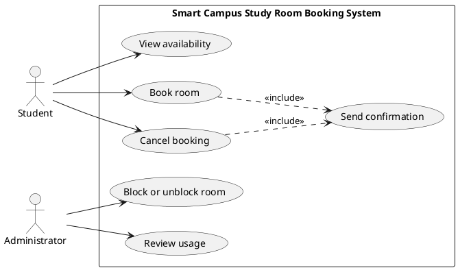

# Lab report — Practice #03, Requirements Engineering with AI

Name: Yernur
Student ID: 25B032075
GitHub username: amanqoss

---

## 1. Setup

| | |
| --- | --- |
| AI assistant (tool) | ChatGPT |
| Exact model name and version | GPT-5.6 Luna |
| Date of the session | 12 October 2026 |
| Diagram renderer used | [ENTER RENDERER USED, OR "not rendered"] |

One tool and one model were used for the three prompts (confirm they were all run with GPT-6).

---

## 2. Original AI output — user stories (Part 1)

The following is the original response supplied from Prompt 1, unchanged in wording.

```text
Smart Campus Study Room Booking — User Stories
Student Goals
Students want to find available study rooms, book rooms, view their reservations, and cancel bookings when necessary.

Administrator Goals
Administrators want to manage study rooms and monitor reservations to ensure efficient room usage.

User Stories
ID

User Story

Priority

Assumption

US-01

As a Student, I want to view available study rooms, so that I can find a suitable room for studying.

High

Room availability information is maintained by the system.

US-02

As a Student, I want to book an available study room, so that I can reserve a space for studying.

High

Students can only book available rooms.

US-03

As a Student, I want to view my reservations, so that I can check my upcoming bookings.

Medium

Students can access their own reservations.

US-04

As a Student, I want to cancel my reservation, so that I can release a room I no longer need.

High

Only existing reservations can be cancelled.

US-05

As an Administrator, I want to manage study room information, so that room details remain accurate.

High

Administrators have permission to update room information.

US-06

As an Administrator, I want to view room reservations, so that I can monitor room usage.

Medium

Administrators can access reservation records.

Review Summary
Total user stories: 6

Actors: Student, Administrator

High priority: 4

Medium priority: 2

Format: All stories follow "As a [role], I want [goal], so that [reason]."

Assumptions: One assumption per story.

Scope: No payment, notification, or other additional features introduced.

Note: These stories are a provisional draft. The exact six use cases and four business rules from week-03/README.md section 1 are not available in this message, so full scenario compliance still needs to be verified against that section.
```

---

## 3. Story review (Part 2)

| Story (as generated) | What I did | Why | Final ID |
| --- | --- | --- | --- |
| US-01 | Clarified | Added time-slot specificity for UC-01 | US-01 |
| US-02 | Clarified | Reflected booking rules R1–R4 | US-02 |
| US-03 | Replaced | Viewing personal reservations is outside the six named use cases; used UC-06 booking confirmation instead | US-03 |
| US-04 | Clarified | Restricted cancellation to own reservation | US-04 |
| US-05 | Replaced | General room-information management is too broad; restricted to UC-04 block/unblock | US-05 |
| US-06 | Revised | UC-05 requires usage over a period rather than merely viewing reservations | US-06 |
| New | Added | Added cancellation confirmation as a separate Student outcome supported by UC-06 | US-07 |

**Did the assistant invent anything outside the scenario?** US-03 added a new view-my-reservations function not in UC-01–UC-06. US-05 added editing room details and general room management, which is outside the six functions. Both were removed or narrowed.

**How many stories did you end with, and why that number?** Seven. They cover the six use cases, with distinct booking and cancellation confirmation outcomes.

---

## 4. Original AI output — acceptance criteria (Part 3)

The following is the original response supplied from Prompt 2, unchanged in wording.

```text
Smart Campus Study Room Booking System — Acceptance Criteria
1. Assumptions
Students can view, create, and cancel their own bookings.

Administrators can manage room information and view all reservations.

Booking start times must be in the future.

A booking cannot exceed two hours.

Two bookings for the same room cannot overlap.

Blocked rooms cannot be booked.

Booking start times must be earlier than end times.

The system stores room availability and reservation information.

2. User Stories and Acceptance Criteria
US-01: View Available Study Rooms
User Story: As a Student, I want to view available study rooms, so that I can find a suitable room for studying.

Priority: High

Acceptance Criteria:

Given rooms are available, When the student searches for a future time slot, Then the system displays available rooms.

Given a room is already booked for the selected time, When the student searches, Then the system excludes that room.

Given a room is blocked, When the student searches, Then the system does not show it as available.

Given the selected time is in the past, When the student searches, Then the system displays a validation error.

US-02: Book a Study Room
User Story: As a Student, I want to book an available study room, so that I can reserve a space for studying.

Priority: High

Acceptance Criteria:

Given a room is available, When the student books a valid future time slot, Then the system confirms the booking.

Given the selected start time is in the past, When the student submits the booking, Then the system rejects it.

Given the booking duration exceeds two hours, When the student submits the booking, Then the system displays a validation error.

Given the room has an overlapping booking, When the student tries to reserve it, Then the system rejects the booking.

Given the room is blocked, When the student attempts to book it, Then the system displays an error and does not create a booking.

US-03: View My Reservations
User Story: As a Student, I want to view my reservations, so that I can check my upcoming bookings.

Priority: Medium

Acceptance Criteria:

Given the student has reservations, When they open their reservations, Then the system displays their bookings.

Given reservations are displayed, When the student selects a reservation, Then the system shows its room, date, and time.

Given the student has no reservations, When they open the reservation page, Then the system displays a message indicating no bookings exist.

Given the student requests a reservation belonging to another student, When the system checks access, Then access is denied.

US-04: Cancel a Reservation
User Story: As a Student, I want to cancel my reservation, so that I can release a room I no longer need.

Priority: High

Acceptance Criteria:

Given the student has an active reservation, When they cancel it, Then the system confirms cancellation.

Given a reservation is cancelled, When the room availability is updated, Then the reserved time slot becomes available unless blocked or otherwise booked.

Given the reservation does not exist, When the student attempts to cancel it, Then the system displays an error.

Given the reservation belongs to another student, When cancellation is attempted, Then the system rejects the request.

US-05: Manage Study Room Information
User Story: As an Administrator, I want to manage study room information, so that room details remain accurate.

Priority: High

Acceptance Criteria:

Given the administrator provides valid room details, When they add a room, Then the system saves the new room.

Given an existing room is selected, When the administrator updates its information, Then the system saves the changes.

Given required room information is missing, When the administrator submits the changes, Then the system displays a validation error.

Given the administrator blocks a room, When a student attempts to book it, Then the system rejects the booking.

Given a blocked room is unblocked, When students search for available rooms, Then the room can appear if it has no overlapping reservations.

US-06: View All Reservations
User Story: As an Administrator, I want to view room reservations, so that I can monitor room usage.

Priority: Medium

Acceptance Criteria:

Given reservations exist, When the administrator opens the reservation list, Then the system displays all reservations.

Given reservations are displayed, When the administrator selects a reservation, Then the system shows its room, student, date, and time.

Given no reservations exist, When the administrator opens the reservation list, Then the system displays an empty-list message.

Given a user does not have administrator permission, When they attempt to view all reservations, Then the system denies access.

3. Business Rule Coverage
Business Rule

Covered In

Bookings must be in the future

US-01, US-02

Maximum booking duration is 2 hours

US-02

Rooms cannot have overlapping bookings

US-01, US-02, US-04, US-05

Blocked rooms cannot be booked

US-01, US-02, US-04, US-05

Summary: 6 user stories, 26 acceptance criteria, and 4 required business rules covered. Each story includes successful behavior and an error, validation, or alternative case.
```

---

## 5. Criteria review (Part 3)

| Criterion (as generated) | Problem | What I changed it to | Final ID |
| --- | --- | --- | --- |
| US-01, four criteria | Generated criteria for an unselected story | Removed from final criteria file, while retaining US-01 as a story | none |
| US-02 future-time rule | Original did not test the exactly-two-hours permitted boundary | Added acceptance for exactly two hours | AC-03 |
| US-02 overlapping bookings | Needed an observable conflict case | Specified conflicting time interval | AC-04 |
| US-03, four criteria | Viewing own reservations is not a defined use case | Removed | none |
| US-04 cancellation | Original split cancellation result across multiple steps | Specified released slot and confirmation as observable cancellation outcomes | AC-06 |
| US-05 room creation/editing | Invented room creation/editing outside UC-04 | Replaced with block/unblock behavior | AC-09, AC-10, AC-11 |
| US-06, four criteria | Reservation listing differs from usage review over a period; unselected story | Removed from selected criterion sets | none |

**The two open questions.**

| Question | My decision | Why |
| --- | --- | --- |
| A booking ending exactly when another begins — overlap under R3? | allowed | Adjacent time intervals share no occupied time |
| Is exactly two hours allowed under R2? | allowed | "At most two hours" includes two hours |

**Which invalid or boundary case did the assistant leave out?** US-02 omitted an explicit successful case for exactly two hours and did not explicitly settle touching interval boundaries under R3. Final AC-03 addresses the duration boundary; the overlap assumption states the interval interpretation.

---

## 6. Original AI output — use-case diagram (Part 4)



Rendered diagram (image, or a link): [ADD RENDERED DIAGRAM LINK OR WRITE "Not rendered"]

---

## 7. Diagram review (Part 4)

| Element | Problem | What I changed |
| --- | --- | --- |
| UC-01, UC-02, UC-03 | No problem: linked to Student | Kept unchanged |
| UC-04, UC-05 | No problem: linked to Administrator | Kept unchanged |
| UC-06 | No problem: included from UC-02 and UC-03; no direct actor link | Kept unchanged |

**Associations.** None were unjustified in the original: Student performs UC-01/02/03; Administrator performs UC-04/05. UC-06 is included as an automatic confirmation action from UC-02 and UC-03, not initiated directly by either actor.

**Did any screen, database or internal component appear as a use case or an actor?** No. The original has exactly two actors and six defined business use cases.

---

## 8. Traceability (Part 5)

- Use cases with **no story** behind them: none.
- Stories with **no use case** they belong to: none.
- Criteria that test **no rule** from section 1: AC-06, AC-07, AC-08, and AC-10 address workflow or ownership rather than directly testing R1–R4.

**What does the largest gap tell you about the generated requirements?** UC-01 and UC-05 have no directly selected acceptance criteria. UC-06 confirmation is only tested through booking and cancellation. This is a documented gap, not a fabricated requirement.

---

## 9. Checker runs

Run these commands from inside week-03 and paste BOTH actual outputs below, unedited.

```text
$ python tests/check_requirements.py
[PASTE REAL OUTPUT]
```

```text
$ python tests/validate_submission.py
[PASTE REAL OUTPUT]
```

| | PASS | FAIL | ERROR |
| --- | --- | --- | --- |
| `check_requirements.py` | [REAL] | [REAL] | [REAL] |

Commit these numbers were produced at (`git rev-parse --short HEAD`): [REAL COMMIT]

**Every FAIL, one line each: what it is and what you decided to do about it.** [FILL FROM REAL CHECK]

**Did you run the checks by hand instead of with Python?** No, provided the real commands were run.

---

## 10. Conclusion (150–200 words)

The initial AI response provided a useful structure for Smart Campus requirements, but its scope needed review. The most important issue was US-05: it proposed managing room information, whereas the supplied scenario only allows an Administrator to block or unblock a room. US-03 also introduced viewing personal reservations, which was not a named use case. Comparing every story to UC-01 through UC-06 exposed these additions without relying on a checker.

The assistant did well at organizing two actors and producing a readable PlantUML diagram with six use cases. Its diagram associated the Student with viewing availability, booking and cancellation, while the Administrator was connected to blocking rooms and reviewing usage. The confirmation use case was included from booking and cancellation rather than triggered directly by an actor. This would have taken longer to construct manually.

Before handing the specification to a developer, I would rewrite US-05 first. Without a narrow outcome, someone might implement room creation or editing, which the scenario excludes. I also settled two boundary decisions: bookings that meet exactly at their endpoints are allowed, and exactly two hours is permitted. These explicit assumptions make the resulting acceptance criteria easier to test.